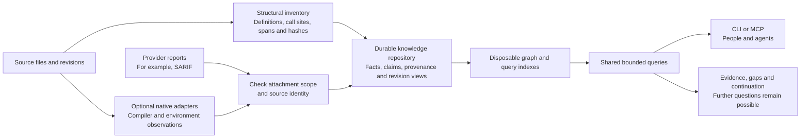
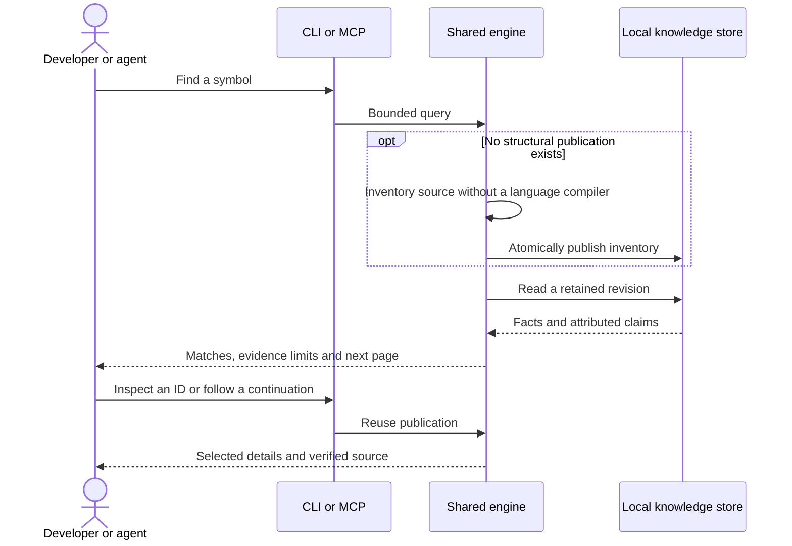
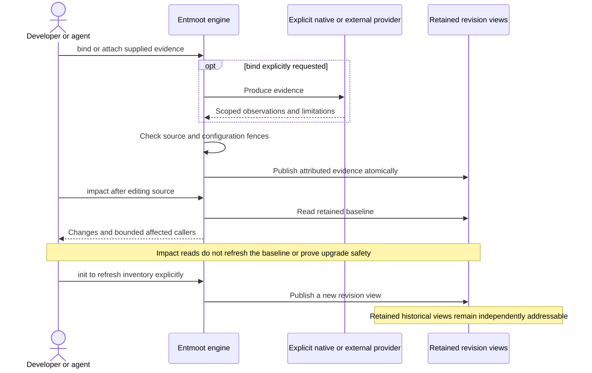

# Entmoot: reusable code context, with evidence and limits

Which callers does my diff touch? Which tests have evidence connecting them to
those changes? Where does that evidence stop?

Entmoot answers those questions with retained source identities, bounded CLI/MCP
queries and explicit unknown, partial and stale results. It refuses to conclude
that an unresolved call or an unreported test is absent. Call paths and clone
candidates do not prove runtime behavior or safety.

Rust, Python, JS/TS/TSX, Go, Java, C# and C have structural inventory. C++ is
experimental. Structural operation requires no language compiler at runtime.
Native adapters add environment-dependent evidence when explicitly requested.

## How the pieces fit

An *occurrence* is one definition at a particular source location and revision.
A *claim* is an attributed observation about it or a relationship. Two identical
function bodies can share a structural hash while remaining distinct occurrences.



The model, storage, evidence, query, native execution and operations have separate
crate owners. CLI and MCP compose them through `entmoot-workspace`;
`entmoot-engine` remains a re-export facade for one release. The read service
builds independently with `cargo test -p entmoot-query`; its `query_scale_bench`
example measures read latency without a native-producer dependency.
Native evidence preserves structural identities.
[Architecture and invariants](docs/architecture/ARCHITECTURE.md) define the DAG.

## Start locally

From this checkout (Rust toolchain selected by `rust-toolchain.toml`):

```text
cargo install --path crates/entmoot-cli --locked
cargo install --path crates/entmoot-mcp --locked
entmoot -C /path/to/project find entmoot_smoke_fn
entmoot -C /path/to/project status
entmoot -C /path/to/project boundaries --callee "*.toString()" --outcome unsupported
```

After the alpha is published, registry installation uses
`cargo install entmoot --version <published-version> --locked` and the equivalent command
for `entmoot-mcp`. The repository's version is a release candidate until the
protected release workflow succeeds; local tests do not establish publication.

Run inside the source repository or select it with `-C`. First use automatically
creates a structural inventory and private local storage under `~/.entmoot`
(override with `--data-dir` / `ENTMOOT_DATA_DIR`). Structural publications and
native artifacts share the selected storage volume outside the checkout. Invalid
or remote configuration fails visibly before selecting storage.
Later reads reuse the current immutable publication.
No database setup is required. Remote storage is not implemented.

```text
entmoot find entmoot_smoke_fn
entmoot inspect <id-returned-by-find>
entmoot callers <id-returned-by-find>
entmoot callees <id-returned-by-find>
entmoot read-source src/main.rs --start-line 1 --end-line 30
entmoot impact
entmoot init
```

`impact` compares the retained baseline with working-tree changes. `init`
explicitly refreshes that baseline and adapter discovery. A read does not silently
replace history, refresh stale source, launch native tools or migrate old stores.
Verified source reads report source drift. Terminals receive readable output;
`--json` and redirected output receive the typed JSON contract. Use `--detail
explain` for evidence and `--detail export` for the full bounded result. Search
limits and compact presentation limits are separate; preserve returned cursors.



## Choose an operation

Use returned IDs instead of guessing names. `entmoot <command> --help` and the
generated [schemas](crates/entmoot-contracts/generated/README.md) own the complete
syntax. These entry points cover the operator workflows:

| Question or action | Commands / starting syntax |
|---|---|
| Find code and verify its source | `find entmoot_smoke_fn`, `inspect <id>`, `read-source src/main.rs --start-line 1 --end-line 30` |
| Navigate represented calls and open work | `callers <id>`, `callees <id>`, `boundaries --reason indirect_call`; `neighborhood`, `trace-seeded-paths`, `call-components` for bounded graph views |
| Understand inventory and evidence coverage | `status`, `inventory`, `audit-calls`; `artifact` and `query` for retained evidence |
| Refresh or enrich knowledge explicitly | `init`, `bind`, `attach`; `deps` for declared dependency subjects |
| Investigate a change or upgrade | `impact`, `assess overlay`, `relay-impact`, `assess`, `revalidate`; [impact](docs/runbooks/impact.md) and [compatibility](docs/runbooks/compatibility.md) explain their distinct guarantees |
| Inspect identities and review clone candidates | `hash --help`, `policy`, `assess clones`; use a `CloneRequest` for explicit budgets and filters in the [worked examples](docs/runbooks/revision-evaluation.md) |
| Plan or execute attributed work | `plan-analysis`, `work`, `validate-tests`; planning never launches a compiler or scanner |
| Manage retained state and local collaboration | `storage-plan`, reviewed `storage-apply`, `collaborate`; `fingerprint` identifies compatible readers |
| Reuse a portable query or evaluate fixtures | `request --example unresolved`, `request --request query.json`, `request --batch --request queries.json`; `validate-ground-truth` checks labeled fixtures |

Start with compact output. Request `--detail explain` when deciding whether a
result applies, or `--detail export` for a bounded machine export. Follow
`page.next_cursor` for presentation pages. Call neighborhoods can also return
`unresolved_continuation`, an independent inspect request for open attempts;
finishing the concrete-edge page does not finish that frontier. The
[MCP continuation guide](crates/entmoot-mcp/README.md) describes both cursors.

The [worked workflow guide](docs/runbooks/revision-evaluation.md) includes Express
upgrade investigations, route-to-provider paths with explicit pruning, clone
outliers and SARIF attachment. Its mock provider facts are authored fixtures;
the separately measured runtime observations have their own evidence limits.

## Native evidence and open boundaries

Build/install the CLI with `--features producer` for in-process Rust Analyzer/Oxc
and its matched `entmoot-producer` helper. Other adapters require explicit
[setup](docs/runbooks/resolver-adapters.md); setup and analyzed project builds can
execute project code and belong in a trusted, isolated environment.
`entmoot bind` requires native support for inventoried languages. Missing tools
fail visibly; `--structural-only` is an explicit waiver. `init`/`bind` never install
SDKs or download toolchains.

```text
entmoot boundaries --callee "object.toString()" --detail export
entmoot boundaries --callee "*.toString()" --outcome unresolved --detail export
entmoot boundaries --reason indirect_call --detail export
```

Boundary queries count distinct source call sites, preserve source spans/digests,
original unresolved attempts and attributed native targets/dispatch detail.
`unreported` means no retained observation, not an absent call. `*.toString()` is
a syntax pattern; it does not infer the receiver's native type. Providers may
report different outcomes for the same site; their partitions can overlap.
Select a `--build-context` to narrow evidence. Unknown contexts are rejected.
Results retain publication/site/artifact selectors that a future provider can
use to attach additional evidence without rewriting structural identity.

Call-graph completeness has independent **repository**, **dependencies** and
**native libraries** scopes. External edges do not by themselves invalidate
represented repository edges. They also do not prove repository closure:
implicit calls, unresolved local dispatch and external callbacks remain possible.
All three scopes currently report `not_established`; producer completion is not
an exhaustive closure claim.

## MCP and integrations

Start `entmoot-mcp -C /path/to/project`, optionally with the same `--data-dir`.
It prepares/reuses the same workspace and serves shared engine operations over
stdio. First-time inventory can delay startup; later publication loading is
asynchronous. `--tools-schema` emits generated input schemas without opening a
workspace. The [MCP guide](crates/entmoot-mcp/README.md) covers bounded output,
shared loopback service, authentication and explicit producer execution.

Compare workflows have distinct meanings: [impact and inventory overlay](docs/runbooks/impact.md)
versus optional [package API compatibility](docs/runbooks/compatibility.md).
Missing package evidence returns `incomplete_bind`; it is not a safe upgrade.



## What the hashes mean

Entmoot-owned identity digests use BLAKE3. A hash identifies its declared input
and policy, not an arbitrary notion of program equivalence. Composite keys frame
components and optional scope fields so distinct addresses cannot merge merely
because delimiters or omitted fields line up.

| Family in the contracts | Meaning and important limit |
|---|---|
| `ContentDigest`, source digests | Exact selected bytes or a declared serialized input; used for source verification and cache fences. |
| `ExactBodyId`, `StructuralHash` | Exact sealed source-span bytes / normalized syntax under a policy. Structural hashes do not recursively include callees' implementations. |
| `PolicyId`, `LogicId` | Normalization policy identity / policy plus structural hash. Compare under the same policy. |
| `AddressId`, logic address, occurrence identity | Locate a definition site; the enclosing publication supplies its revision. Identical bodies do not collapse distinct sites. An address alone does not identify a snapshot. |
| Signature, module-shell and file hashes | Callable boundary / surrounding non-body structure / Merkle combination of callable and module information. The file hash is structural, not an exact byte digest. |
| `ResolvedHash`, native publication identity | Optional native meaning under a particular environment and evidence publication; never substitutes for structural identity. |
| Syntax, alpha and literal-parameterized clone fingerprints | Review candidates at progressively different normalization grains. Alpha accounts for binding relationships; parameterized matches may hide meaningful literal differences. |
| Canon term, form and obligation digests | An explicit supported semantic subset with types, assumptions and definedness. Partial forms are excluded from canonical clone claims; this is not a general equivalence proof. |
| Proposition, relation-edge, claim and unresolved-attempt IDs | Distinct relationship, scoped occurrence, attribution and open-work identities. Explicit disagreement remains attached to the original edges. |
| Artifact, attachment, finding, configuration and implementation fingerprints | Evidence identity and compatibility fences. Contract, derivation and storage-layout changes can require a matching historical reader or explicit rebuild. |

Git object IDs retain Git's own algorithm and spelling; package URLs are names,
not content hashes. The [typed IDs](crates/entmoot-contracts/src/ids.rs),
[relation contracts](crates/entmoot-contracts/src/relation.rs) and
[identity walkthrough](docs/architecture/ARCHITECTURE.md) own the exact encoding.

## Evidence so far

The frozen [history pilot](docs/runbooks/revision-evaluation.md#history-inventory-evidence-2026-10-17)
selected 72 of 80 planned comparison pairs from 988 first-parent candidates in
eight purposively chosen repositories: Express, Fastify, Requests, docker-py,
Axum, getrandom, chi and Gin. All 72 source-delta checks and 139 retained revision
inventories matched independent Git-byte oracles, covering 19,188 selected-source
file memberships. Eight failed-CI sampling slots were unavailable. CI failures
are sampling metadata, not proof that a code change caused a failure.

This supports **bounded historical source-inventory utility**. Observations are
clustered within eight repositories; they do not establish callable completeness,
dispatch accuracy, upgrade safety or security detection. The persisted database
used 15.14 GiB of logical storage, excluding Git acquisitions; initialization
commands totaled 1,404.3 seconds and 215 completed retention attempts, including
replay, totaled 3,495.6 seconds. These are local debug-build observations under
uncontrolled load, not whole-study elapsed time or production benchmarks.

The [Express release cohort](docs/runbooks/revision-evaluation.md#release-cohort-evidence-2026-10-17)
covered eight pinned versions from 4.18.2 through 5.1.0: 12 authored cases per
version, 96 runtime observations, 96 attachments and 16 historical views. Across
40 paired queries preserving the same finding IDs, compact output had a median
1,455 `o200k_base` tokens versus 9,091.5 for export; the median paired reduction
was 84.1%. This measures **response volume**, not AI reasoning cost or savings
against grep. One framework family and repeated authored cases do not support a
population-wide claim.

**AI research trials: zero executed attempts.** A six-task paired calibration
(up to 12 attempts, two minutes each) is prepared and paused. Provider adapters
are separated from task preparation, grading and reporting. No answer-quality,
reasoning-token, billed-cost or agent-productivity advantage has been established.
The [frozen manifest](evals/experiments/history-pilot-2026-10-17/manifest.json),
selection, grades and cost receipts support replay; the
[evaluation skill](.agents/skills/entmoot-evaluate/SKILL.md) explains how to keep
pins, denominators, failed attempts and unknown measurements explicit.

## Implementation maturity

Reviewed 2026-10-18. Maintain this table with the owning controls whenever behavior
or qualification changes. **Alpha candidate** means implemented and locally
controlled; **partial** means useful evidence with material gaps. No row claims
exhaustive language semantics or runtime/security proof.

The [recorded alpha sample](docs/runbooks/local-alpha.md#fresh-alpha-evidence-2026-10-16)
covers 5,407 call sites across four pinned publications and 47 verified source
digests/spans, with build and native-scope limitations kept explicit. That historical
sample does not establish current release readiness; the repaired controls still
require [release qualification](PLANNING.md#current-qualification-blockers).

Large-repository performance remains partial. The
[full Go characterization](evals/experiments/performance-streamed-go-2026-10-19.json)
at `84bd4a7` published 11,832 parsed files in 23.8 minutes with 0.50GB sampled peak
RSS; single-file edits still took 12.5–13.8 minutes. Exact path/ID and source
reads took 3–5ms inside the engine, but cold subject context still loaded a graph
and took 154s. The runner's final recovery assertion failed; independent post-hoc
checks verified recovery and preserved that failure. The newer incremental
publisher awaits the same full-corpus qualification. [PLANNING](PLANNING.md)
records the remaining costs and earlier attempts.

| Capability | Maturity | Utility and limit / verification owner |
|---|---|---|
| Structural inventory and identities | Alpha candidate | Compiler-free source/revision navigation; parsing is not compiler qualification. [Revision controls](crates/entmoot-core/tests/revision_pairs.rs) |
| Automatic local storage and recovery | Alpha candidate | Shared home/custom volumes, fail-closed config and budget admission; restart/history and source preservation in [workspace controls](crates/entmoot-cli/tests/workspace_defaults.rs) and [explicit-write controls](crates/entmoot-cli/tests/artifact_cli.rs). |
| CLI/MCP navigation and source | Alpha candidate | Shared bounded operations and digest-verified reads; first inventory has a startup cost. [Transport controls](crates/entmoot-mcp/tests/stdio_e2e.rs) |
| Source/native call boundaries | Partial | Distinct-site counts and retained native detail; repository/dependency/native-library completeness remains separately unestablished. [Boundary controls](crates/entmoot-engine/tests/call_boundaries.rs) |
| Native binding/dispatch | Partial, per configuration | Repository/external/intrinsic/unknown observations; no universal closed-world claim. [Native qualification](.github/workflows/native.yml) |
| Revision impact and scoped overlay | Alpha candidate | Scope/signature/multiplicity-aware presence deltas; not API compatibility. [Overlay owner](crates/entmoot-topology/src/overlay.rs) |
| Provider observations and workflow evaluation | Partial, bounded cohort | Eight pinned Express releases, 96 runtime observations and 16 verified historical views. One framework family; no population or agent-cost qualification. [Study and limits](docs/runbooks/revision-evaluation.md#release-cohort-evidence-2026-10-17) |
| Consumer/provider compatibility | Partial | Authored positive/negative controls; missing import/export scope remains incomplete. [Controls](crates/entmoot-engine/tests/package_compatibility.rs) |
| Dependency materialization | Alpha candidate | Confined staged copying, opaque version keys, symlink rejection and resource bounds. [Safety owner](crates/entmoot-native/src/materialize.rs) |
| Test impact / unused candidates | Partial | Review and test-selection assistance; no coverage or dead-code proof. [Testing](docs/runbooks/testing.md) |
| Canon / clone candidates / collaboration | Experimental | Explicit evidence policies and local recovery; no runtime equivalence proof or remote collaboration service. [Architecture](docs/architecture/ARCHITECTURE.md) |
| Registry packages / generated docs / CI | Qualification pending | Local regression repairs and controls passed; the exact candidate still needs hosted structural/native and extracted-package gates. [Release gates](docs/runbooks/local-alpha.md) |
| Remote storage / global package catalog | Planned, unimplemented | Future location transport must preserve publication, provenance, query and mutation semantics. |

## Maintain and release

This README is the main operator entry. [Architecture](docs/architecture/ARCHITECTURE.md)
is the meaning walkthrough. Public API and engine semantics live in crate rustdoc;
CLI help, MCP `--tools-schema` and [generated JSON Schema](crates/entmoot-contracts/generated/README.md)
own interface and wire shape—no hand-maintained copies. Short [runbooks](docs/README.md)
hold procedures only. [AGENTS](AGENTS.md) owns maintainer/agent invariants (update
in the same turn as durable changes); [llms.txt](llms.txt) is a static link to this
repository. [Planning](PLANNING.md) and [changelog](CHANGELOG.md) track active and
delivered work. Skills under [.agents/skills](.agents/README.md) give short
operator/release workflows.

The [local alpha guide](docs/runbooks/local-alpha.md) covers the prior corpus
sample, validation, upgrade/rebuild policy, private-repository Pages setup and
handoff to `tim-gowan/entmoot`. Local pre-commit is ownership-scoped and fast;
CI is authoritative: structural + repo + policy (`ci.yml`), resolved native
(`native.yml`), docs staging under `.tmp/staging` (`docs.yml`), optional corpus
demo (`demo.yml` dispatch). Configuration and harness unit tests run independently
of Rust builds. Docs and PR classification reuse the binaries qualified by CI;
Ubuntu/Windows and structural/producer feature sets remain distinct qualifications.
Tag CD (`release.yml`) publishes crates then deploys the qualified docs artifact.
Publish only the exact revision that passes
structural and resolved gates.

## Prior art and building blocks

Entmoot uses [Tree-sitter](https://tree-sitter.github.io/tree-sitter/) for structural
syntax and [BLAKE3](https://github.com/BLAKE3-team/BLAKE3) for its own identity
digests. Provider interchange includes
[OASIS SARIF 2.1.0](https://docs.oasis-open.org/sarif/sarif/v2.1.0/sarif-v2.1.0.html);
attaching a report preserves its attribution rather than validating its verdict.

The alpha-clone summary kernel adapts the compositional idea in Maziarz, Ellis,
Lawrence, Fitzgibbon and Peyton Jones,
[Hashing Modulo Alpha-Equivalence (PLDI 2021)](https://arxiv.org/abs/2105.02856).
Entmoot's binding-incidence encoding and supported language policies differ from
the paper's lambda-calculus encoding; the paper's proof is not a proof of this
implementation. [Architecture](docs/architecture/ARCHITECTURE.md) records the
adaptation and finite oracle controls.

MIT OR Apache-2.0. Bundled grammar sources retain their upstream licenses.
